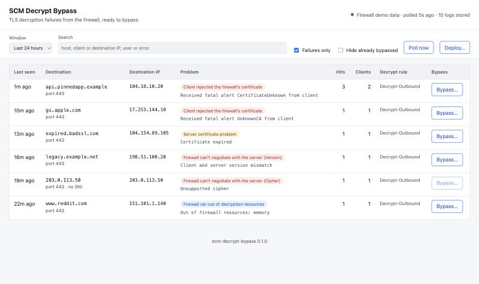
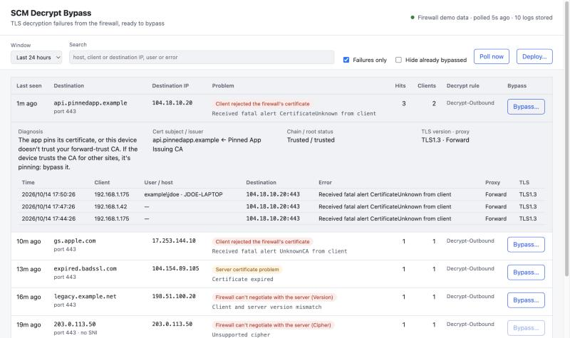
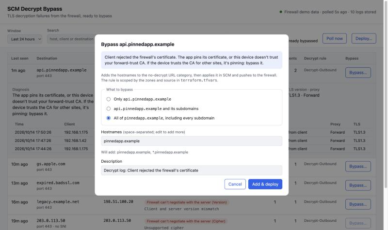
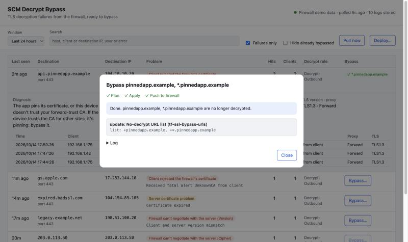

# Using scm-decrypt-bypass

## The web GUI

The dashboard lists every destination with decryption failures in the chosen
window, newest first. A destination is the TLS hostname (SNI), or the server
certificate's name if there's no SNI, or the IP address if there's neither.

| Column | |
|---|---|
| **Last seen** | Most recent failure. Hover for the exact time. |
| **Destination** | Hostname and port. A trailing `…` means the firewall's log cut the name short (see [below](#truncated-hostnames)). |
| **Destination IP** | Every IP seen for it (CDNs often have many). Hover for the full list. |
| **Problem** | A plain-English diagnosis and the raw error. |
| **Hits / Clients** | Failed sessions and distinct client IPs. Hover *Clients* for the IPs. |
| **Decrypt rule** | The decryption rule that tried to decrypt it. |
| **Bypass** | **Bypass…**, or ✓ and the list entry that already covers it. |

Filters: the time window, a search box (hostname, client or destination IP,
user, error text), **Failures only** (untick to also see successful sessions,
including traffic your bypasses match), and **Hide already bypassed**.
**Poll now** fetches new logs immediately instead of waiting for the next
poll (every 5 minutes by default).

Click a row to see its individual sessions: time, client, user and host,
destination, error, proxy type and TLS version.

### What the diagnoses mean

| Diagnosis | Usually means | Bypass? |
|---|---|---|
| **Client rejected the firewall's certificate** | The app pins its certificate, or this device doesn't trust your forward-trust CA. If the device trusts the CA for other sites, it's pinning. | Yes, if it's pinning. Otherwise install your CA on the device. |
| **Firewall doesn't trust the server's certificate chain** | The site uses its own private CA, or the firewall is missing a public intermediate or root CA. | For private-CA sites, yes. For a missing public CA, import it on the firewall instead. |
| **Server certificate problem** | Expired, self-signed or incomplete server certificate. | Only for sites you trust; a bypass hides the problem from users. |
| **Firewall can't negotiate with the server** | TLS version, cipher, client certificates or an oversized chain that the decryption profile can't handle. | Usually yes. |
| **Firewall ran out of decryption resources** | A capacity problem on the firewall. | No; fix the capacity. |
| **Session resumption failed** | Usually harmless; the client retries. | No. |

When the same error appears across many unrelated sites, the cause is likely
the decryption profile or firewall, not the sites.

### Bypassing a destination

Click **Bypass…**:

1. Choose **what to bypass**: only that hostname; the hostname and its
   subdomains; or the whole domain (e.g. `example.com` and `*.example.com`).
   *Will add* shows exactly what goes into the list, and you can edit the
   hostnames before adding.
2. Optionally change the description, which is stored with each entry and
   shown in SCM.
3. Click **Add & deploy**.

The deploy panel then shows each step: plan, apply, push to firewall.

- **Applied without asking** only when the plan changes nothing but the
  no-decrypt URL list (and, the first time, creates its rule).
- **Stops for review** if anything else would change: other rules, settings
  you edited in `terraform.tfvars`, deletions, or changes someone made in SCM
  by hand. It lists every change: **Apply & push** continues, **Cancel** takes
  your new entries back out of the list, and **Later** leaves the review
  waiting.
- If **the push fails**, the change is already in SCM. **Retry push** sends it
  again without re-applying.

You can close the panel while a deploy runs; a banner at the top shows its
progress. Only one deploy runs at a time.

Destinations with no hostname can't go in the URL list (the button is greyed
out). Add their IP from the CLI: `scm-decrypt-bypass add destination 203.0.113.50`.

### Deploy…

**Deploy…** (top right) plans whatever is pending, such as edits to
`terraform.tfvars` or lists you changed by hand, and always stops for review. If
there's nothing to apply but an earlier push failed, it offers **Push to
firewall**.

### Truncated hostnames

Decryption logs store at most 31 characters of the hostname, plus its real
length. When the server certificate's name is exactly that long and starts the
same way, the viewer uses it. Otherwise it shows the cut-off name with `…`, and
the bypass dialog asks you to complete it before adding.

## The command line

In Docker, prefix commands with `docker compose exec scm-decrypt-bypass`.

| Command | |
|---|---|
| `scm-decrypt-bypass` | Interactive menu: add, remove, list, plan, deploy |
| `scm-decrypt-bypass add url example.org --subdomains -d "Vendor app"` | Add entries. Kinds: `url`, `category`, `destination`, `source`, `user`. |
| `scm-decrypt-bypass remove url example.org` | Remove entries (also `exclusion`) |
| `scm-decrypt-bypass list [kind]` | Show the lists |
| `scm-decrypt-bypass plan` | Show what would change in SCM (read-only) |
| `scm-decrypt-bypass deploy` | Plan, confirm, apply, push, and wait for each firewall's result |
| `scm-decrypt-bypass deploy --no-push` | Apply to SCM only; push later |
| `scm-decrypt-bypass push` | Push without applying (e.g. retry a failed push) |
| `scm-decrypt-bypass init` | Create the data directory and starter files |
| `scm-decrypt-bypass serve` | Run the web GUI |
| `scm-decrypt-bypass version` | Print the version |

`add` and `remove` only edit the lists; add `--deploy` to deploy straight away.
Entries are cleaned up as they're added: pasted URLs become hostnames, case and
trailing slashes are normalised, and duplicates are skipped. `--subdomains`
turns `www.example.org` into `example.org` and `*.example.org`.

`deploy` and `push` only include the service account's own changes. Add
`--all-admins` to push everything that's pending in the folder.
